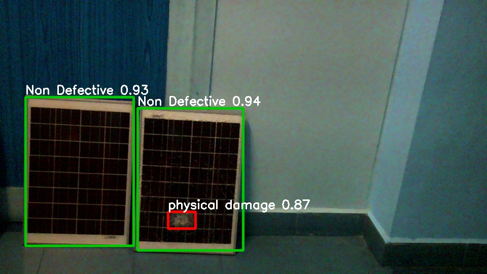
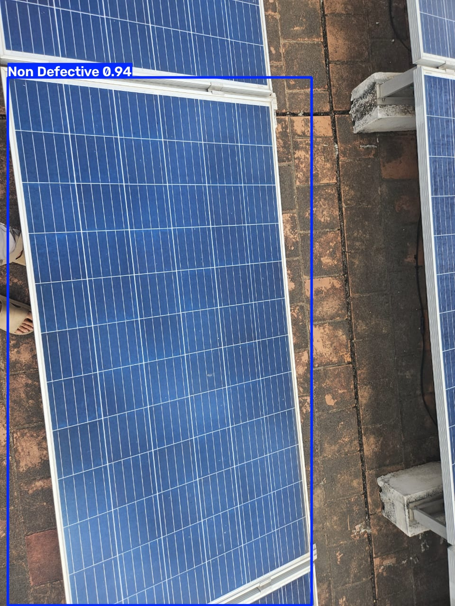

# UAV-Based Solar Panel Fault Detection (YOLOv26 + Raspberry Pi)

Real-time detection of solar panel faults from a camera feed, running on a Raspberry Pi 4.
A YOLOv26 model classifies each panel region as **Non Defective**, **dirty**, or **physical damage**,
logs every fault with a timestamp and bounding box, and saves annotated frames while recording video.

Final-year capstone project, B.Tech ECE, VIT.



## Results

| Model | mAP@50 (validation) |
|---|---|
| YOLOv11n | 96.3% |
| **YOLOv26n** | **96.5%** |

Both models were trained on the same 3-class Roboflow dataset. YOLOv26 also gave better predictions
on our own rooftop photos, so it is the model deployed on the Pi.



## How it works

1. **Training:** YOLOv26n trained with Ultralytics on a Roboflow dataset (3 classes).
2. **Export:** the trained model is exported to ONNX (`models/best_yolo26.onnx`) so the Pi can run it with ONNX Runtime, without PyTorch.
3. **On-device inference:** `pi/live_detect.py` records 1080p video from the Pi Camera while running detection on a 960x540 stream. Fault frames are saved at most once per second, and every fault is written to `detections.csv`.

## Repository layout

```
pi/
  live_detect.py     live detection + video recording on the Raspberry Pi
  video_detect.py    ONNX inference code; can also record a clip and process it afterwards
training/
  test_model.py      run the trained .pt model on a folder of test images
models/
  best_yolo26.pt     trained YOLOv26 weights (PyTorch)
  best_yolo26.onnx   same model exported to ONNX for the Pi
results/
  sample_detections/ annotated output images
  field_logs/        detections.csv from live runs on the Pi
```

## Hardware

- Raspberry Pi 4, run headless over SSH
- Raspberry Pi Camera Rev 1.3 (OV5647)

## Running it

On the Raspberry Pi (Raspberry Pi OS with `picamera2` installed):

```bash
pip install -r requirements-pi.txt
cd pi
python3 live_detect.py        # runs until Ctrl+C
python3 live_detect.py 60     # stops after 60 seconds
python3 video_detect.py record 30          # record a 30 s clip, then analyse it
python3 video_detect.py process clip.mp4   # analyse an existing video
```

Outputs go to `runs/<timestamp>/`: the video, `detections.csv`, and annotated images of each fault.

On a PC, to test the PyTorch model on images:

```bash
pip install ultralytics
cd training
python test_model.py   # reads ./test_images, saves annotated results under runs/
```

## Sample log

From a live run on the Pi (`results/field_logs/run_20261012_172413.csv`):

| time | class | confidence |
|---|---|---|
| 17:24:14 | physical damage | 0.665 |
| 17:24:30 | physical damage | 0.873 |
| 17:24:32 | physical damage | 0.694 |

## Tech stack

Python, Ultralytics YOLO, PyTorch, ONNX Runtime, OpenCV, NumPy, Picamera2, Roboflow, Raspberry Pi OS
